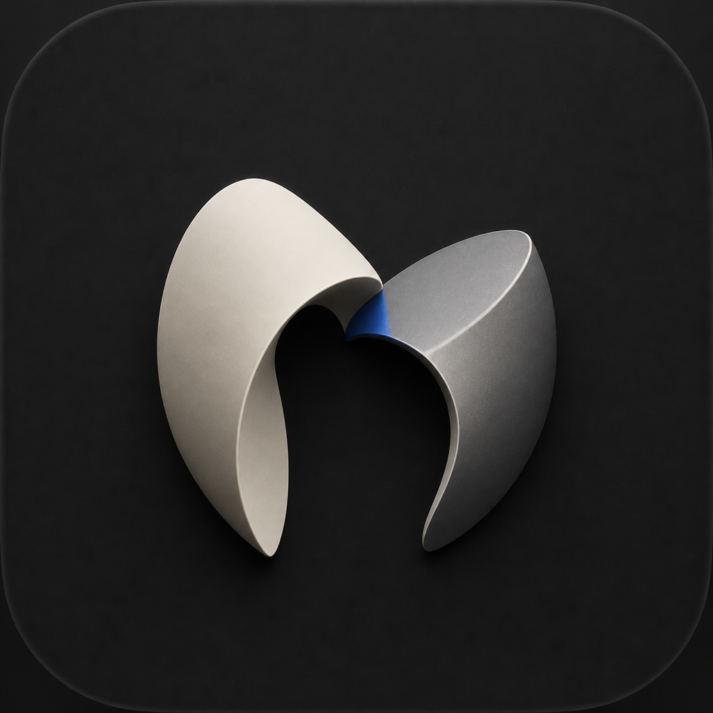

# Mien

[](https://github.com/kohoj/mien/actions/workflows/ci.yml) [](LICENSE) 

<p align="center"></p>

<p align="center"><strong>Your intent, in context.</strong></p>

Mien is a quiet native macOS intelligence layer that brings a user-owned Codex to the point of intent. Press one global shortcut while pointing at content. Mien freezes the exact app, window, semantic element, selection, and input epoch before its own UI appears; gathers only the context the request needs; and returns the result beside its source. When an editable field can be proven, the user may explicitly insert a draft, verify it by reading it back, and undo it. Mien never sends a message.

> **Developer preview.** The source and universal development bundle are usable today. The bundle is ad-hoc signed because this repository does not possess a Developer ID identity; it is not a notarized consumer release.

## Download the developer preview

[Download the universal macOS app](https://github.com/kohoj/mien/releases/download/v0.1.0-alpha.1/Mien-development-unnotarized-macos.zip) · [SHA-256](https://github.com/kohoj/mien/releases/download/v0.1.0-alpha.1/Mien-development-unnotarized-macos.zip.sha256) · [SBOM](https://github.com/kohoj/mien/releases/download/v0.1.0-alpha.1/mien.cdx.json) · [release notes](https://github.com/kohoj/mien/releases/tag/v0.1.0-alpha.1)

Download the archive and checksum into the same folder, then verify before opening:

```bash
shasum -a 256 -c Mien-development-unnotarized-macos.zip.sha256
```

Unzip the app, move it to Applications, then Control-click it in Finder and choose **Open** on the first launch. That explicit Gatekeeper path is required only because this developer preview is not notarized; do not disable Gatekeeper or remove quarantine attributes globally.

## Try it from source

Requirements: macOS 14+, Xcode with Swift 6, Git, npm, `jq`, and Bun 1.3.13.

```bash
git clone https://github.com/kohoj/mien.git
cd mien
scripts/verify-mien.sh
scripts/assemble-app.sh
open .build/distribution/Mien.app
```

`assemble-app.sh` resolves only the revisions in `Config/runtime-manifest.json`, builds both Apple Silicon and Intel slices, merges universal helpers, signs the bundle inside-out, and verifies every nested executable and digest. It does not discover production helpers from `PATH`.

On first use, press **Control–Option–Space**. Mien reuses a private existing Codex login when one is safely available; otherwise it presents the official Codex device-login URL and one-time code, then resumes the original request. Accessibility and Screen Recording are requested only when the chosen scope needs them.

## Trust boundary

```text
hotkey -> immutable target lease -> deterministic policy
       -> selection / Accessibility / bounded Longview context
       -> private immutable artifacts -> destination disclosure
       -> supervised codex-acp + Codex -> native result
       -> explicit typed mutation -> read-back verification -> undo
       -> verified cleanup + durable recovery journal
```

Mien exposes no generic shell, click, keystroke, clipboard, or unrestricted filesystem capability to the agent. Inbound ACP permission requests are denied unless a typed broker owns the exact operation. Process exit, model prose, and tool return values never become success facts.

## What is implemented

- Exact WindowServer + Accessibility target leases and stale-target refusal.
- Minimum-context provider ladder with explicit local/remote destination disclosure.
- Background-only [Longview](https://github.com/kohoj/longview) capture with restoration receipts.
- Pinned Codex 0.145.0 and `codex-acp` 1.1.7, bounded processes, cancellation, deadlines, output caps, and integrity checks.
- Native Codex device login with a product-owned private credential home.
- Compare-and-swap AX draft insertion, read-back verification, automatic rollback, and a 30-second undo window.
- A segmented, fsynced, owner-only recovery journal whose closed segments are immutable.
- One native task surface that can detach to a single menu-bar task center and restore without losing the frozen task.
- Reproducible universal `arm64 + x86_64` app assembly and opt-in live ACP probes.

## System modules

| Module | Single owner |
|---|---|
| `InteractionShell` | global shortcut, semantic lens, composer, result presentation |
| `PermissionKernel` | just-in-time Accessibility and Screen Recording authorization |
| `InvocationKernel` | immutable WindowServer and AX target identity |
| `ContextKernel` | minimum-context provider ordering, budgets, coherence, omissions |
| `ProviderAdapters` | selection, Accessibility, and Longview translations |
| `ArtifactStore` | private 0600 atomic artifacts and deterministic cleanup |
| `PolicyKernel` | subject, operation, sensitivity, and destination policy |
| `ACPGateway` | stable ACP v1 framing, process isolation, restart containment |
| `SubprocessKernel` | bounded process groups, cancellation, output and deadline fences |
| `TaskRuntime` | monotonic event-sourced task truth |
| `ActionKernel` | exact grants and verified typed mutations |
| `DesktopActionAdapters` | the single narrow Accessibility draft transaction |
| `MemoryKernel` | provenance-backed, explicitly approved memory claims |
| `HostRuntime` | composition only; no platform mechanism ownership |

Start with [release status](docs/mien/release-status.md), [architecture](docs/mien/architecture.md), [interaction system](docs/mien/interaction-system.md), [quality gates](docs/mien/quality-gates.md), [distribution](docs/mien/distribution.md), [brand](docs/brand.md), and [contributing](CONTRIBUTING.md).

Bundled runtime attribution and source revisions are in [third-party notices](THIRD_PARTY_NOTICES.md) and `Config/runtime-manifest.json`; complete license texts are embedded in every assembled app.

## Longview boundary

[Longview](https://github.com/kohoj/longview) remains an independent MIT-licensed CLI and bounded-history sensor. Mien consumes only its schema-v2 artifact and restoration receipt; it does not copy Longview implementation source.

## License

MIT. See [LICENSE](LICENSE).
