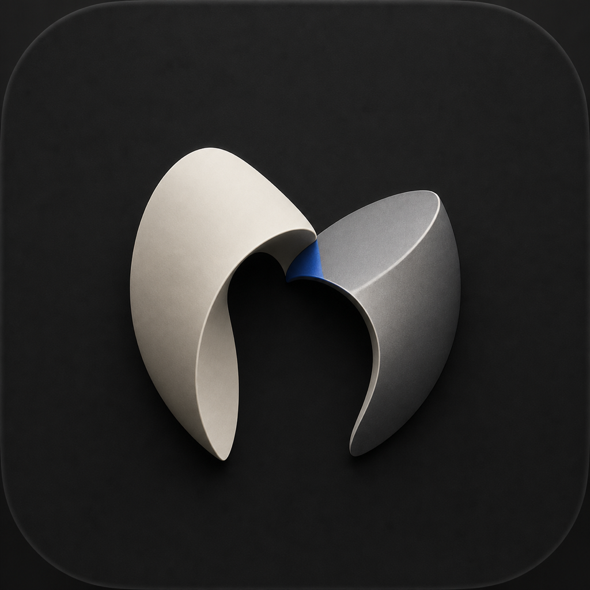

# Mien

[](https://github.com/kohoj/mien/actions/workflows/ci.yml) [](LICENSE) 

<p align="center"></p>

<p align="center"><strong>Your intent, in context.</strong></p>

Mien is a quiet native macOS intelligence layer that brings a user-owned Codex to the point of intent. Press one global shortcut while pointing at content. Mien freezes the exact target, gives your words verbatim to one Agent session, acquires only the typed evidence that Agent requests, and returns the result beside its source. When an editable field can be proven, the user may explicitly insert a typed draft proposal, verify it by reading it back, and undo it. Mien never sends a message.

> **Developer preview.** The source and universal development bundle are usable today. The bundle is ad-hoc signed because this repository does not possess a Developer ID identity; it is not a notarized consumer release.

## Download the developer preview

[Download the universal macOS app](https://github.com/kohoj/mien/releases/download/v0.1.0-alpha.1/Mien-development-unnotarized-macos.zip) · [SHA-256](https://github.com/kohoj/mien/releases/download/v0.1.0-alpha.1/Mien-development-unnotarized-macos.zip.sha256) · [SBOM](https://github.com/kohoj/mien/releases/download/v0.1.0-alpha.1/mien.cdx.json) · [release notes](https://github.com/kohoj/mien/releases/tag/v0.1.0-alpha.1)

Download the archive and checksum into the same folder, then verify before opening:

```bash
shasum -a 256 -c Mien-development-unnotarized-macos.zip.sha256
```

Unzip the app, move it to Applications, then Control-click it in Finder and choose **Open** on the first launch. That explicit Gatekeeper path is required only because this developer preview is not notarized; do not disable Gatekeeper or remove quarantine attributes globally.

## Try it from source

Requirements: macOS 14+, Xcode with Swift 6, Git, npm, `jq`, and Bun 1.3.13.

```bash
git clone https://github.com/kohoj/mien.git
cd mien
scripts/verify-mien.sh
./script/build_and_run.sh --verify
```

`script/build_and_run.sh` is the single contributor run entrypoint and powers the Codex Run action. It delegates bundle creation to `scripts/assemble-app.sh` and exact-process installation to `scripts/install-app.sh`; the underlying assembler resolves only the revisions in `Config/runtime-manifest.json`, builds both Apple Silicon and Intel slices, merges universal helpers, signs the bundle inside-out, and verifies every nested executable and digest. It does not discover production helpers from `PATH`.

First launch presents one next step at a time: connect the ChatGPT account, authorize a reading capability, then use **Control–Option–Space** in the current window. Missing credentials use Pi's official OpenAI device-code flow inside Mien, followed by a verified Agent handshake and live model discovery. A second reading capability is optional. Permission controls open the exact System Settings pane; the attached guide helps add Mien to Apple's list, while live preflight APIs alone prove authorization.

An ordinary click on Mien's menu-bar mark exposes the current action, **Settings…**, and Quit. **Command–Comma** opens a separate compact Settings window for account, live models, permissions, and shortcut guidance. A retained conversation is labelled **Continue conversation** and restores its original target. Settings never doubles as a first-run welcome page.

The Agent resolves Codex authentication before its readiness handshake, model-session creation, and each user turn. An OAuth refresh failure is a typed authentication failure: Mien offers **Connect ChatGPT** instead of retrying the same expired credential. Clicking it starts the bundled device-login flow, displays the code inside Mien, and opens the official authorization page. After authorization, Mien verifies the connection and resumes the original immutable turn through normal submission: it renews the exact original target and creates a fresh task while preserving an existing idle Agent conversation. A changed target is refused. No terminal command is needed.

## Trust boundary

```text
hotkey -> immutable target lease -> verbatim input to one Agent session
       -> typed context decision: none or one exact evidence request
       -> deterministic Host policy -> selection / AX / frame / history if requested
       -> private immutable artifacts -> destination disclosure
       -> same Agent session -> typed answer or draft proposal
       -> explicit typed mutation -> read-back verification -> undo
       -> verified cleanup + durable recovery journal
```

Mien exposes no generic shell, click, keystroke, clipboard, or unrestricted filesystem capability to the Agent. Pi's coding-session loader, built-in tools, ambient extensions, skills, context files, and MCP configuration are absent. The only model-callable tools are typed `request_context` and `submit_outcome`; a provider-enforced state machine exposes exactly one at a time and the Host validates both. Process exit, model prose, and tool return values never become success facts.

## What is implemented

- Exact WindowServer + Accessibility target leases and stale-target refusal.
- Agent-owned typed evidence selection, including Accessibility plus visual context, with explicit local/remote destination disclosure.
- Background-first [Longview](https://github.com/kohoj/longview) capture that fails unless any activation, viewport, focus, and pointer changes are restored and verified.
- Pinned Pi Agent 0.82.1, bounded process transport, cancellation, deadlines, output caps, and integrity checks.
- One provider-enforced Pi tool loop per turn: the Agent explicitly selects no context or one catalog request, then submits the typed outcome without a Host-side intent parser, fallback prompt, or second planning call.
- Unified Agent connection, native Codex-subscription device login, and a product-owned private Pi credential directory.
- Live `openai-codex` model selection in Settings, applied before the next task receives user input. Setup asks for a model only when a saved choice is no longer available.
- Compare-and-swap AX draft insertion, read-back verification, automatic rollback, and a 30-second undo window.
- A segmented, fsynced, owner-only recovery journal whose closed segments are immutable.
- One native task surface that can detach to a single menu-bar task center and restore without losing the frozen task.
- Reproducible universal `arm64 + x86_64` app assembly and opt-in live Pi Agent probes.

## System modules

| Module | Single owner |
|---|---|
| `InteractionShell` | global shortcut, semantic lens, composer, result presentation |
| `PermissionKernel` | just-in-time Accessibility and Screen Recording authorization |
| `InvocationKernel` | immutable WindowServer and AX target identity |
| `ContextKernel` | minimum-context provider ordering, budgets, coherence, omissions |
| `ProviderAdapters` | selection, Accessibility, and Longview translations |
| `ArtifactStore` | private 0600 atomic artifacts and deterministic cleanup |
| `PolicyKernel` | subject, operation, sensitivity, and destination policy |
| `ACPGateway` | bounded NDJSON-RPC framing, child isolation, restart containment |
| `SubprocessKernel` | bounded process groups, cancellation, output and deadline fences |
| `TaskRuntime` | monotonic event-sourced task truth |
| `ActionKernel` | exact grants and verified typed mutations |
| `DesktopActionAdapters` | the single narrow Accessibility draft transaction |
| `MemoryKernel` | provenance-backed, explicitly approved memory claims |
| `HostRuntime` | composition only; no platform mechanism ownership |

Start with [release status](docs/mien/release-status.md), [architecture](docs/mien/architecture.md), [interaction system](docs/mien/interaction-system.md), [quality gates](docs/mien/quality-gates.md), [distribution](docs/mien/distribution.md), [brand](docs/brand.md), and [contributing](CONTRIBUTING.md).

Bundled runtime attribution and source revisions are in [third-party notices](THIRD_PARTY_NOTICES.md) and `Config/runtime-manifest.json`; complete license texts are embedded in every assembled app.

## Longview boundary

[Longview](https://github.com/kohoj/longview) remains an independent MIT-licensed CLI and bounded-history sensor. Mien consumes only its schema-v2 artifact and restoration receipt; it does not copy Longview implementation source.

## License

MIT. See [LICENSE](LICENSE).
